<!-- ========================================================================= -->
<!-- 00 // HEADER: MINIMALIST ETCHED STONE LOTUS RELIEF (TRANSPARENT SVG)      -->
<!-- ========================================================================= -->

 

  &nbsp;
  &nbsp;
  

<!-- ========================================================================= -->
<!-- 01 // SELECTED WORKS: STRUCTURED FROM SURFACE TO CORE ENGINE              -->
<!-- ========================================================================= -->
<table width="100%">
  <tr>
    <td colspan="2">
      <code>01 // INTERFACE &amp; AI</code> — <i>Product experience and intelligent workflows</i>
    </td>
  </tr>
  <tr>
    <td width="50%" valign="top">
       
      <b><a href="https://ai-resume-o92e.vercel.app/">Resume AI</a></b> &nbsp;<code>LIVE ↗</code> 
      AI-assisted resume builder using the Gemini API to turn career notes into structured documents.  
      <code>Next.js</code> · <code>Gemini API</code> · <code>TypeScript</code>
        
    </td>
    <td width="50%" valign="top">
       
      <b><a href="https://keylab-lake.vercel.app/">KeyLab</a></b> &nbsp;<code>LIVE ↗</code> 
      Minimalist e-commerce storefront designed for custom mechanical keyboards and peripherals.  
      <code>React</code> · <code>JavaScript</code> · <code>E-Commerce</code>
        
    </td>
  </tr>

  <tr>
    <td colspan="2">
      <code>02 // SAAS PLATFORMS</code> — <i>Multi-tenant state, security triage, and billing</i>
    </td>
  </tr>
  <tr>
    <td width="50%" valign="top">
       
      <b><a href="https://zero-grid.by.yashwantgawande.com/">ZEROGRID</a></b> &nbsp;<code>LIVE ↗</code> 
      Cybersecurity issue management platform for structured vulnerability tracking and triage.  
      <code>SaaS</code> · <code>Security</code> · <code>Full-Stack</code>
        
    </td>
    <td width="50%" valign="top">
       
      <b><a href="https://synch-sass.vercel.app/">Synch</a></b> &nbsp;<code>LIVE ↗</code> 
      Real-time collaborative SaaS platform integrated with automated Stripe subscription billing.  
      <code>React</code> · <code>Node.js</code> · <code>Stripe</code>
        
    </td>
  </tr>

  <tr>
    <td colspan="2">
      <code>03 // CORE ENGINE &amp; BACKEND</code> — <i>Concurrency, relational data, and microservices</i>
    </td>
  </tr>
  <tr>
    <td width="50%" valign="top">
       
      <b><a href="https://github.com/yashng7/modmail-plus">Modmail Plus</a></b> &nbsp;<code>REPO ↗</code> 
      Concurrent Discord ticket engine written in Go with persistent state in PostgreSQL.  
      <code>Go</code> · <code>PostgreSQL</code> · <code>Concurrency</code>
        
    </td>
    <td width="50%" valign="top">
       
      <b><a href="https://github.com/yashng7/credit-approval-system">Credit Approval System</a></b> &nbsp;<code>REPO ↗</code> 
      Containerized backend service for evaluating credit risk and automating loan eligibility.  
      <code>Python</code> · <code>Django</code> · <code>Docker</code>
        
    </td>
  </tr>
</table>

<!-- ========================================================================= -->
<!-- 02 // ARCHITECTURE & CREDENTIALS                                          -->
<!-- ========================================================================= -->
<table width="100%">
  <tr>
    <td width="50%" valign="top">
      <code>04 // STACK BY LAYER</code>  
      <b>Interface:</b> &nbsp;<code>React</code> · <code>Next.js</code> · <code>TypeScript</code> · <code>JavaScript</code> 
      <b>Backend:</b> &nbsp;&nbsp;<code>Go</code> · <code>Python</code> · <code>Django</code> · <code>Node.js</code> 
      <b>Systems:</b> &nbsp;&nbsp;<code>PostgreSQL</code> · <code>Docker</code> · <code>AWS</code>
        
    </td>
    <td width="50%" valign="top">
      <code>05 // CERTIFICATIONS</code>  
      <a href="https://www.freecodecamp.org/certification/YashwantGawande/front-end-development-libraries"><b>Front End Development Libraries</b></a> — freeCodeCamp <code>↗</code> 
      <a href="https://www.freecodecamp.org/certification/YashwantGawande/back-end-development-and-apis"><b>Back End Development &amp; APIs</b></a> — freeCodeCamp <code>↗</code>
        
    </td>
  </tr>
</table>
